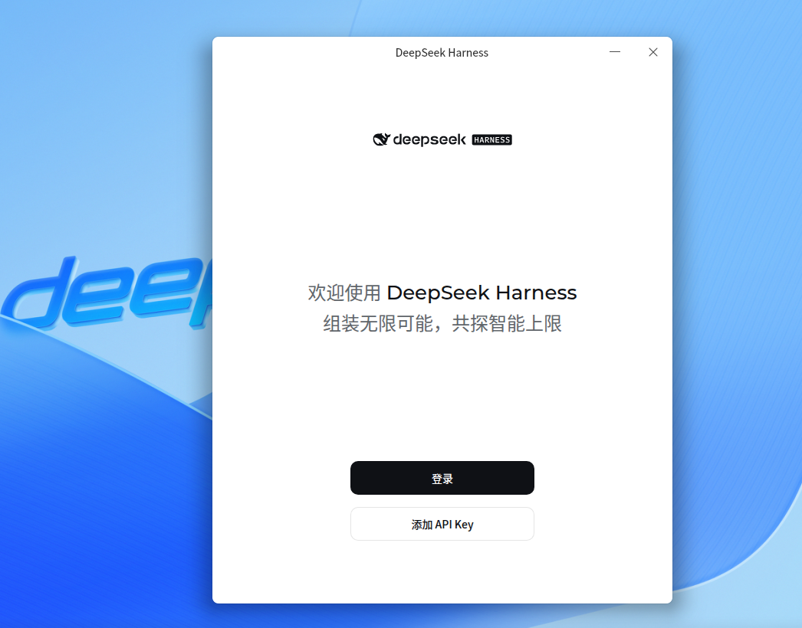
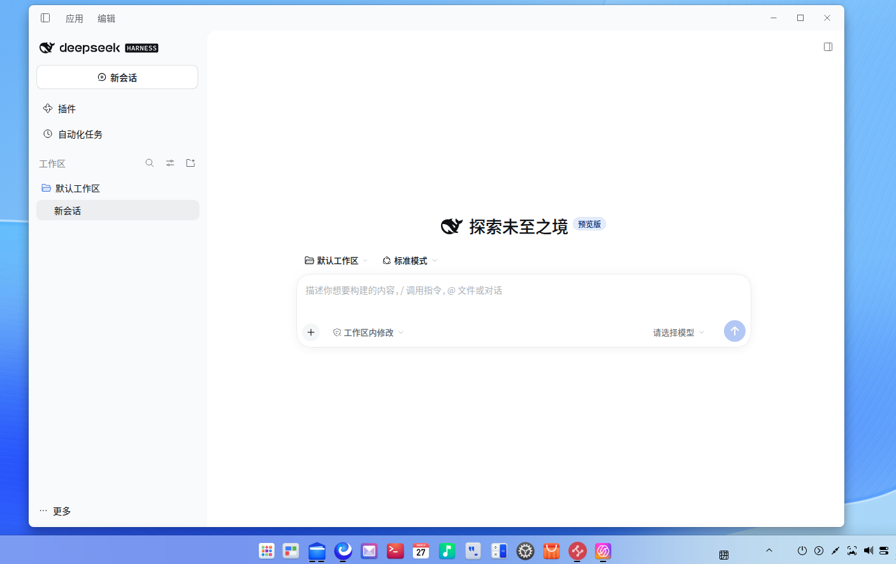
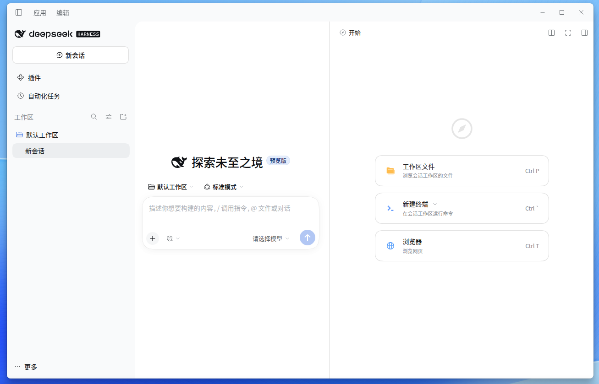
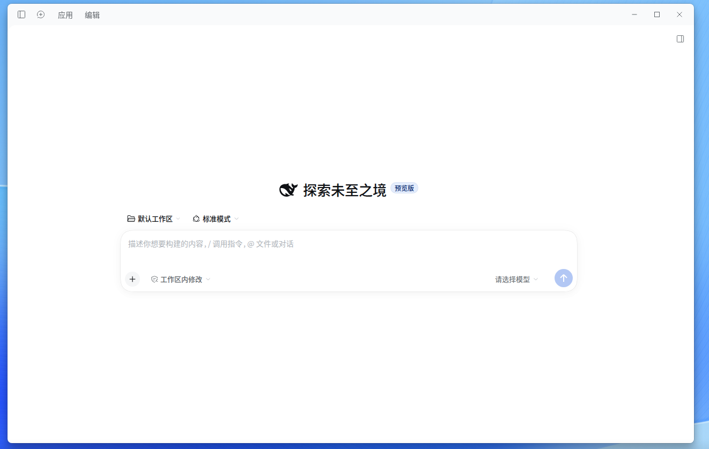

# DeepSeek Harness

English | [中文](README.zh.md)

DeepSeek Harness (`dsh`) is an open-source agent harness developed by [DeepSeek AI](https://deepseek.com).

It is built on an **everything-is-a-plugin** architecture and powered by [Cordis](https://github.com/cordiverse/cordis), whose design is described in [_A Programming Paradigm for Spatiotemporal Composability_](https://arxiv.org/abs/2608.25512).

Documentation: [https://deepseek-harness.github.io/deepseek-harness/](https://deepseek-harness.github.io/deepseek-harness/)

## Branch notes: `linux-custom-titlebar`（分支说明，中文）

> **适配 Deepin v25 系统并测试通过，其它系统需自行测试**

本仓库默认分支 **`linux-custom-titlebar`** 基于官方 [DeepSeek Harness](https://github.com/deepseek-ai/deepseek-harness) 针对 Linux 桌面端进行了优化修改，主要改动如下：

### 1. 自定义标题栏，节约屏幕高度

官方桌面版在 Linux 下使用系统标题栏，「应用 / 编辑」菜单会**单独占据一行屏幕空间**；本分支为 Linux 启用自定义标题栏（`titleBarStyle: hidden`），将「应用 / 编辑」菜单与窗口控制按钮内嵌进标题栏，与 Windows 版体验一致，节约了一整行屏幕高度。

### 2. 去除原生菜单栏，移除多余的「Toggle Developer Tools」调试项

Linux 下原生 GTK 菜单栏会把隐藏的调试菜单项（Toggle Developer Tools）泄漏显示到窗口顶部菜单；本分支在 Linux 下完全抑制原生菜单栏（`Menu.setApplicationMenu(null)`），同时保留应用内绘制的官方「应用 / 编辑」菜单（关于、退出等），界面更干净整洁。

### 3. 系统托盘 + 关闭行为可配置

窗口关闭后应用驻留后台，Linux 托盘图标提供「显示窗口 / 退出」入口，与其他平台体验对齐；同时可在 **通用设置 → 关闭窗口时** 选择点击 X 后的行为：**隐藏到托盘（默认）**或**退出应用**，托盘菜单文案随系统语言切换（中文/English）。

### 4. 启用自动更新（检查更新）

Linux 版启用「检查更新」：更新源指向本仓库稳定的 `linux-latest` Release（每次构建自动刷新为最新版本），AppImage 支持自动下载安装，检查到新版本时展示更新说明。

### 下载安装

- 前往 [Releases 页面](https://github.com/yaoyingkeji/deepseek-harness/releases) 下载 `deepseek-harness-*-linux-x86_64.AppImage` 或 `deepseek-harness-*-linux-amd64.deb`。
- AppImage：`chmod +x deepseek-harness-*.AppImage && ./deepseek-harness-*.AppImage`
- deb：`sudo dpkg -i deepseek-harness-*.deb`（也可直接双击安装）

### 界面截图

| 欢迎界面 | 主界面（自定义标题栏） |
| :---: | :---: |
|  |  |

| 「应用」菜单 | 菜单展开效果 |
| :---: | :---: |
|  |  |

## Developer preview

DeepSeek Harness is in _developer preview_ and iterating rapidly. **THERE WILL BE COMPATIBILITY-BREAKING CHANGES.**

Review the [safety notice](SAFETY.md) before running the project.

## Run

### Run from `npm`

Install `Node.js`, then run:

```sh
npx @deepseek-ai/dsh web
```

The command starts the Web UI at `http://127.0.0.1:3080` by default and opens it in the default browser for a local launch. An SSH launch only prints the host URL because the SSH client or editor owns the local forwarded address. Pass `--no-open` to run the server without opening a browser. See [Web UI guide](docs/user/guide/index.md).

### Run from source

To run from a repository checkout:

```sh
git clone https://github.com/deepseek-ai/deepseek-harness.git
cd deepseek-harness
pnpm install
pnpm run build
pnpm dsh web
```

`pnpm run build` prepares the repository artifacts. `pnpm dsh web` uses those built artifacts without rebuilding.

## Community and support

- Submit feedback or bug reports through [GitHub Discussions](https://github.com/deepseek-ai/deepseek-harness/discussions).
- Add the [`dsh-plugin`](https://github.com/topics/dsh-plugin) topic to your plugin repository for discoverability.
- Join <a href="https://discord.gg/4MrtZUhpxg">DeepSeek Harness Discord community</a>.

## Contributing

See [CONTRIBUTING.md](CONTRIBUTING.md).

## Development

Start with the [development guide](docs/development.md) and [architecture documentation](docs/architecture.md).

`pnpm run dev:web` builds, serves, and rebuilds client bundles on source edits in one terminal, and `make help` lists the matching Make targets for Web and Desktop; the guide's application commands section owns the full table.

For agents, follow [AGENTS.md](AGENTS.md).

## Citation

```bibtex
@misc{deepseek-harness2026,
  title={DeepSeek Harness: Everything is a Plugin},
  author={DeepSeek-AI},
  year={2026},
  publisher={GitHub},
  howpublished={\url{https://github.com/deepseek-ai/deepseek-harness}},
}
```

## License

[MIT](LICENSE)

Third-party dependencies and their licenses are disclosed in [THIRD_PARTY_NOTICES.md](THIRD_PARTY_NOTICES.md).
